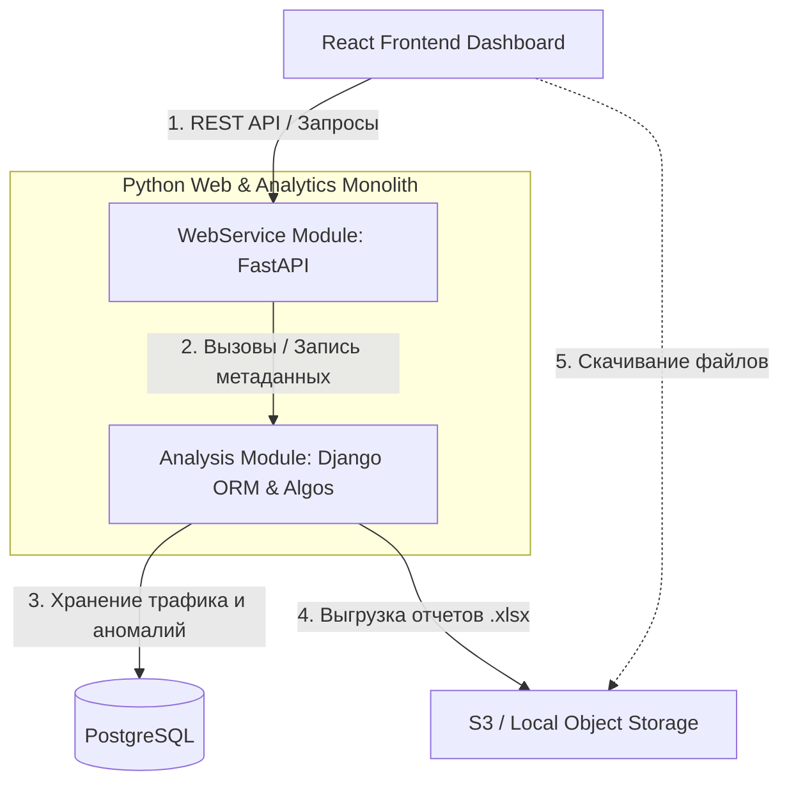

# 4. Архитектура веб-платформы анализа аномалий дорожного трафика (А-134)


## 1. Контекст и бизнес-требования

Система мониторинга дорожного трафика переводится с локального CLI-скрипта на полноценную веб-платформу. Фронтенд разрабатывается на **React** в виде интерактивного дашборда для инженеров безопасности дорожного движения (БДД). 

Бэкенд реализуется в рамках **гибридного монолита на Python**, сочетая в себе два фреймворка: **FastAPI** (для быстрого асинхронного обслуживания веб-запросов фронтенда и отдачи данных) и **Django** (в качестве мощной ORM для работы с реляционной БД, миграциями и административной панелью).

### Набор модулей монолита
Внутри монолита выделяются два независимых бизнес-модуля с четкими границами:
1. **WebService Module (FastAPI):** отвечает за HTTP-эндпоинты, авторизацию пользователей, валидацию загрузки файлов и отдачу готовой аналитики на фронтенд.
2. **Analysis Module (Django ORM + Pandas):** изолированный модуль с алгоритмами парсинга, детекции суточных/месячных аномалий и подготовки аналитических срезов.

## 2. Проблемы текущего подхода

* **Файловый хаос:** Хранение данных в сырых `.xlsx` файлах делает невозможной быструю фильтрацию, поиск исторических максимумов и сквозной YoY (Year-over-Year) анализ.
* **Блокировка UI:** Математический расчет и рендеринг графиков через `matplotlib` — это CPU-интенсивные задачи. Выполнение их в общем потоке веб-сервера приведет к "зависанию" интерфейса у всех пользователей.
* **Отсутствие стандартизации графиков:** Локальные графики генерируются в виде статичных картинок. Фронтенду для интерактивного дашборда (зум, всплывающие подсказки при наведении) нужны сырые структурированные JSON-данные.

## 3. Решение: Гибридный монолит (FastAPI + Django) с БД-ориентированным контрактом

### Архитектурная схема



---

## 4. Контракты таблиц базы данных (Django ORM / PostgreSQL)

Данные из Excel денормализуются и раскладываются по таблицам базы данных.

### 4.1. Таблица `traffic_metrics` (Почасовые логи трафика)
Сюда функция `parse_traffic_excel` записывает каждую валидную строчку.

```python
# analysis/models.py
from django.db import models

class TrafficMetric(models.Model):
    road_section = models.CharField(max_length=255, db_index=True)
    timestamp = models.DateTimeField(db_index=True)
    
    # Интенсивность (Общая и по направлениям)
    vol_total = models.IntegerField()
    vol_direct = models.IntegerField()
    vol_reverse = models.IntegerField()
    
    # Разбивка по типам ТС
    cars_total = models.IntegerField()
    small_trucks_total = models.IntegerField()
    med_trucks_total = models.IntegerField()
    large_trucks_total = models.IntegerField()
    road_trains_total = models.IntegerField()
    buses_total = models.IntegerField()
    motos_total = models.IntegerField()
    
    # Скорость и загрузка
    speed_direct = models.FloatField()
    speed_reverse = models.FloatField()
    load_direct = models.FloatField()
    load_reverse = models.FloatField()

    class Meta:
        unique_together = ('road_section', 'timestamp')
```

### 4.2. Таблица `daily_anomalies` (Реестр суточных инцидентов)
Заполняется модулем анализа. Каждая запись содержит точные числовые факты отклонений.

```python
# analysis/models.py
class DailyAnomaly(models.Model):
    road_section = models.CharField(max_length=255, db_index=True)
    date = models.DateField(db_index=True)
    level = models.CharField(max_length=20, choices=[('Высокий', 'Высокий'), ('Критический', 'Критический')])
    detector = models.CharField(max_length=50)        # Примеры: 'Скорость/Загрузка', 'Датчик', 'Амплитуда'
    anomaly_type = models.CharField(max_length=100)   # Примеры: 'Экстремальный затор', 'Залипание датчика'
    parameter = models.CharField(max_length=100)      # Примеры: 'Мин. скорость (Прямое)', 'Интенсивность'
    fact_value = models.FloatField()                  # Например: 45.5
    norm_value = models.CharField(max_length=50)      # Например: '> 70 км/ч' или 'Медиана'
    deviation_pct = models.FloatField()               # Например: -43.1
    score = models.FloatField()                       # Статистический вес / Z-Score
    description = models.TextField()                  # Текст: "В 18:00 скорость упала до..."
```

---

## 5. Контракты API для Фронтенда (React) и Бэкенда (FastAPI)

Фронтенд больше не запрашивает статические картинки графиков. Бэкенд отдает сырые точки, а React отрисовывает их через интерактивные библиотеки.

### 5.1. GET `/api/v1/dashboard/summary`
Возвращает агрегированную статистику для верхнеуровневых карточек дашборда.

**Response 200**
```json
{
  "period": "2026-10",
  "active_sections_count": 4,
  "total_cars_measured": 1420500,
  "critical_anomalies_active": 3,
  "high_anomalies_active": 8
}
```

### 5.2. GET `/api/v1/anomalies/daily`
Получение списка всех обнаруженных суточных аномалий с фильтрацией.

**Параметры запроса (Query Params):**
* `road_section` (string, опционально) — фильтр по участку дороги.
* `level` (string, опционально) — `Критический` или `Высокий`.

**Response 200**
```json
{
  "items": [
    {
      "id": 1402,
      "road_section": "км 4+000 подъезд к г. Воронеж",
      "date": "2026-10-17",
      "level": "Критический",
      "detector": "Скорость/Загрузка",
      "anomaly_type": "Экстремальный затор",
      "parameter": "Мин. скорость (Прямое)",
      "fact": 45.5,
      "norm": "> 70 км/ч",
      "deviation_pct": -43.1,
      "score": 4.5,
      "description": "В 18:00 скорость упала до 45.5 км/ч при загрузке 22%"
    }
  ]
}
```

### 5.3. GET `/api/v1/charts/daily-history`
Основной контракт для построения интерактивных чартов. Отдает массив из 24 объектов (по часам суток) для выбранной даты и участка.

**Параметры запроса (Query Params):**
* `date` (string, обязательный) — формат `YYYY-MM-DD`.
* `road_section` (string, обязательный) — название участка.

**Response 200**
```json
{
  "date": "2026-10-17",
  "road_section": "км 4+000 подъезд к г. Воронеж",
  "hourly_data": [
    {
      "hour": 0,
      "volume_fact": 120,
      "volume_norm_median": 140,
      "speed_fact_direct": 95.0,
      "speed_norm_median": 90.0,
      "load_fact_direct": 2.1,
      "is_anomaly_hour": false
    },
    {
      "hour": 18,
      "volume_fact": 2450,
      "volume_norm_median": 1800,
      "speed_fact_direct": 45.5,
      "speed_norm_median": 82.0,
      "load_fact_direct": 22.0,
      "is_anomaly_hour": true
    }
  ]
}
```

---

## 6. Спецификация интерактивных чартов на React-дашборде

На основе данных из эндпоинта `/api/v1/charts/daily-history` фронтенд выводит два графика, расположенных вертикально друг под другом с единой осью времени (00:00 - 23:00):

| Название чарта | Тип графика (React) | Отображаемые метрики (из контракта) | Визуальные якоря и логика |
| :--- | :--- | :--- | :--- |
| **Чарт 1: Интенсивность потока** | Гибридный (`Bar` + `Line`) | `volume_norm_median` (серые столбики)<br>`volume_fact` (красная линия) | Столбики показывают историческую медиану месяца. Красная линия наглядно подсвечивает резкие всплески или провалы трафика. |
| **Чарт 2: Скорость движения** | Линейный (`Line` с областями) | `speed_norm_median` (пунктир)<br>`speed_fact_direct` (синяя линия) | Дополнительно наносится горизонтальная статическая линия на отметке **50 км/ч** (Порог затора). |

**Дополнительная интерактивность на фронтенде:**
* Если у часового объекта флаг `is_anomaly_hour === true`, точка на линейном графике подсвечивается крупным красным индикатором-алертом.
* При наведении на точку всплывает кастомный `Tooltip`, отображающий точный процент падения скорости и текущий уровень загрузки дороги (`load_fact_direct`).

## 7. Последствия решения

* **Высокая скорость ответа UI:** Разделение на FastAPI и Django позволяет отдавать легковесные JSON-массивы точек за миллисекунды. Браузер инженера БДД работает плавно без скачивания тяжелых картинок.
* **Контроль блокировок процессов:** Несмотря на монолитную кодовую базу, CPU-интенсивные вычисления (вызовы Pandas-скриптов анализа) вызываются асинхронно из FastAPI через пул процессов/потоков (`run_in_executor`), не забивая основной Event Loop веб-сервера.
* **Переиспользование кода:** Написанные ранее алгоритмы нахождения дельт интенсивности и заторов полностью сохраняются внутри Django-модуля `Analysis`, меняется только интерфейс сохранения результатов (в базу данных вместо консоли).
